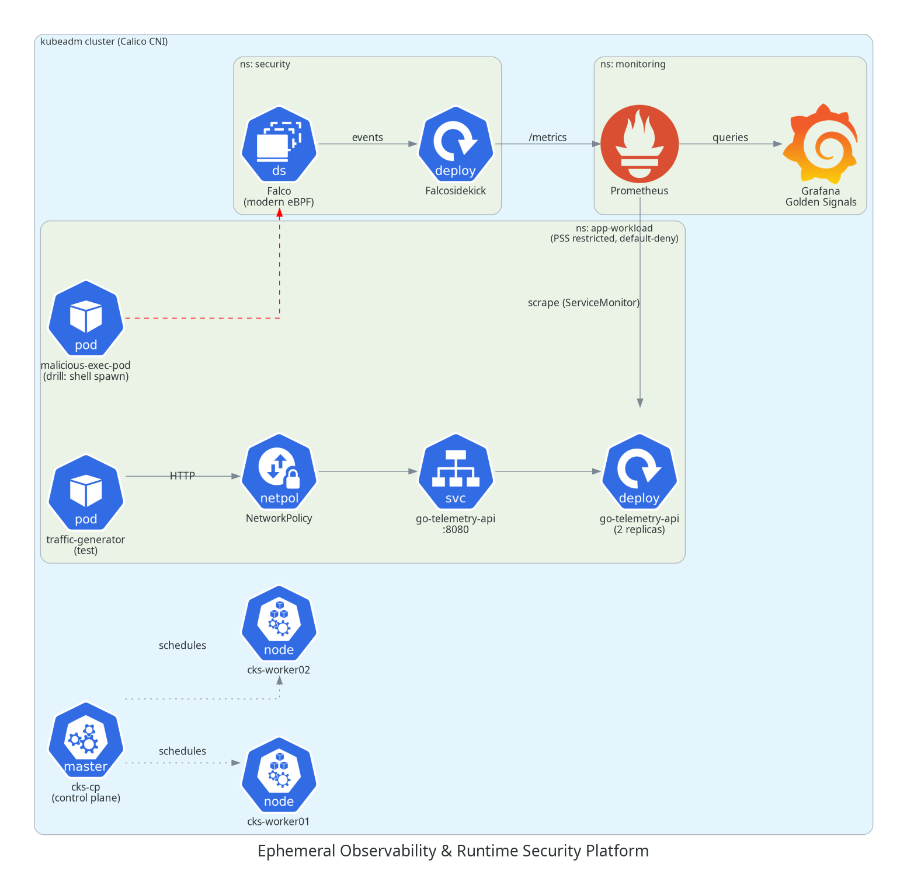

# Ephemeral Observability & Runtime Security Platform

Hardened Go workload on a kubeadm cluster (Calico CNI), with Prometheus/Grafana observability and Falco runtime threat detection.



| Layer | What it does | Location |
|---|---|---|
| Workload | Distroless Go API exposing `/healthz`, `/readyz`, `/api/v1/workload`, `/metrics` | `app/`, `k8s/base/` |
| Security | Pod Security Standards (restricted), default-deny NetworkPolicy, Falco rules | `k8s/security/` |
| Observability | kube-prometheus-stack, ServiceMonitor, Grafana golden-signals dashboard | `k8s/observability/` |
| Cluster | VM provisioning and kubeadm bootstrap scripts | `scripts/`, [docs/cluster-install.md](docs/cluster-install.md) |

## Quick start

```bash
make build-image        # build the container image
make load-image         # import it on the worker nodes
make deploy-monitoring  # Prometheus + Grafana
make deploy-security    # Falco + Falcosidekick
make deploy-app         # workload, NetworkPolicy, ServiceMonitor
make test-traffic       # generate in-cluster traffic
make simulate-attack    # trigger Falco detections
make clean              # tear everything down
```

> `kubectl logs` / `kubectl run -i` need kubelet serving certificates with IP SANs.
> See the prerequisite in [blueprint.md](blueprint.md) (section 7).

## Documentation

- [blueprint.md](blueprint.md): full architecture and configuration reference
- [docs/verification-evidence.md](docs/verification-evidence.md): verification results with screenshots
- [docs/cluster-install.md](docs/cluster-install.md): cluster installation
- [docs/incident-runbook.md](docs/incident-runbook.md): incident drills and expected results

## Verified

| Check | Result |
|---|---|
| PSS blocks privileged pod | Pass |
| Default-deny NetworkPolicy blocks cross-namespace traffic | Pass |
| Falco detects shell spawn in `app-workload` | Pass |
| Prometheus targets UP, Grafana dashboard populated | Pass |
