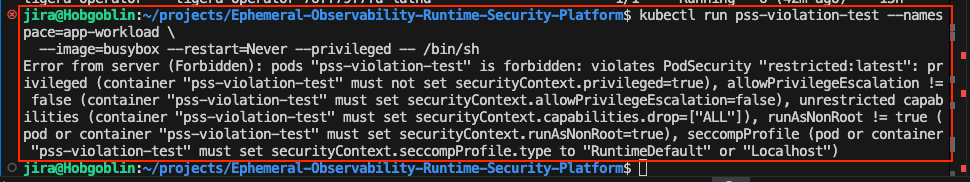
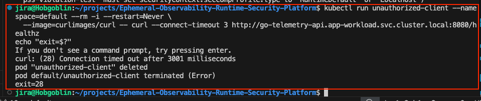
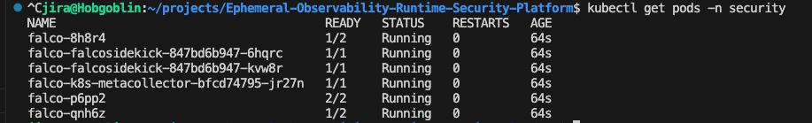
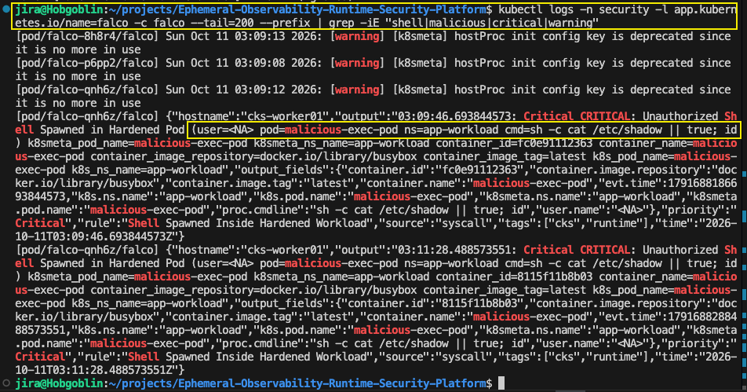
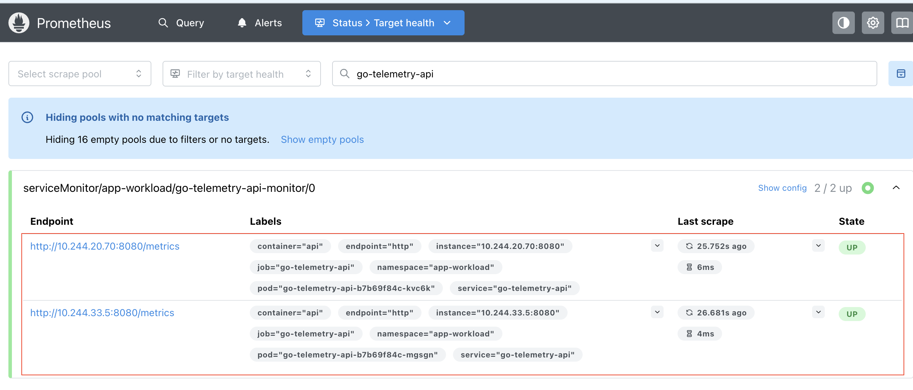
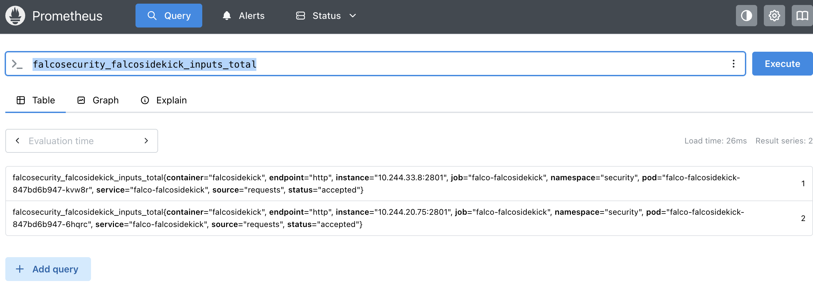
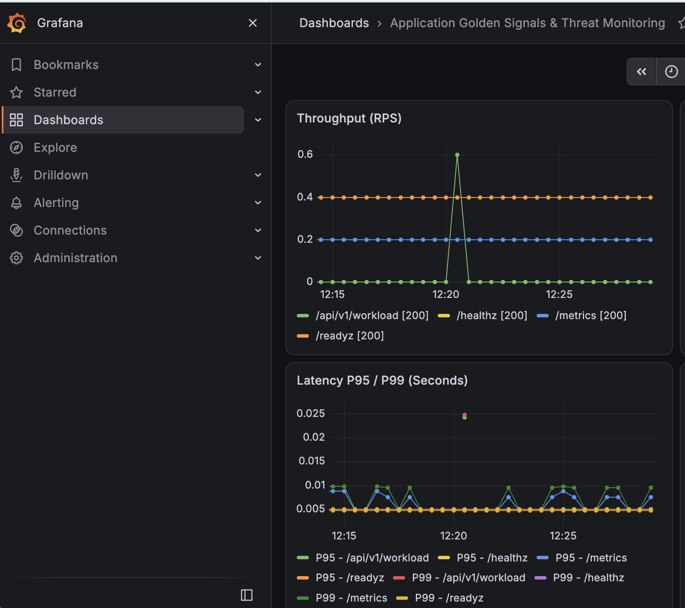

# Verification Evidence

หลักฐานการทดสอบตาม Runbook ใน [blueprint.md](../blueprint.md) หัวข้อ 7 (ทดสอบบน cluster `cks-cp` + `cks-worker01/02`, 2026-10-11)

## Runbook Step 1: Pod Security Standards (PSS)

สร้าง pod แบบ privileged ใน `app-workload` แล้วถูก API server ปฏิเสธด้วย `violates PodSecurity "restricted:latest"`

## Runbook Step 2: Network Isolation (Default-Deny)

pod ใน namespace `default` เรียก `go-telemetry-api` ไม่ได้ (`curl: (28) Connection timed out`)

## Runbook Step 3: Falco Runtime Detection

Falco DaemonSet พร้อมใช้งาน (`2/2 Running` ทุก node):

Alert `Shell Spawned Inside Hardened Workload` จาก `malicious-exec-pod` หลังรัน `make simulate-attack`:

## Runbook Step 4: Prometheus & Grafana

Prometheus target `go-telemetry-api` เป็น **UP (2/2)**:

Metric `falcosecurity_falcosidekick_inputs_total` แสดงว่า Falcosidekick รับ event และถูก scrape:

Grafana dashboard *Application Golden Signals & Threat Monitoring*:

ดูขั้นตอนตอบสนองเหตุการณ์ใน [incident-runbook.md](incident-runbook.md) และการติดตั้ง cluster ใน [cluster-install.md](cluster-install.md)
